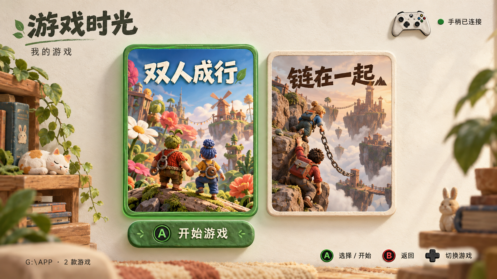

# 游戏时光 · GameTime Launcher

面向 Windows 的中文游戏大厅：用 3D 手绘风格界面展示本地游戏，使用 Xbox 手柄选择并启动游戏。基于 [Playnite](https://github.com/JosefNemec/Playnite) 的全屏模式扩展，另含正在开发的多手机局域网遥控。

> **当前提供基础游戏大厅预览版，手机遥控仍处于开发阶段。** 手机遥控的控制逻辑和模拟页面测试已通过，但包含联网服务的新版 EXE 在本地部署时被 Windows 拦截，尚未完成服务部署和真实手机扫码验收。下载预览版不启用手机服务，不建议通过关闭系统防护来处理开发版检测。

## EXE 下载

- **推荐：[完整便携包与校验文件](https://github.com/ID-LiuDaZhi/gametime-launcher/releases/tag/v0.1.0-preview)**。下载 `GameTime-Windows-v0.1.0-preview.zip`，完整解压后打开 `GameTime\GameTime.exe`，保留旁边的 `Playnite` 文件夹。
- [单独下载启动器 GameTime.exe](https://github.com/ID-LiuDaZhi/gametime-launcher/raw/refs/heads/main/downloads/GameTime.exe)：只适用于已有配套目录的情况，单独下载不能打开完整游戏大厅。

基础启动器 SHA-256：`08ef8d8a0c322a2cc48a7486348d6d14668ae7fe153e8b0efaaf9889aa6069e4`。

预览下载不包含游戏，也不启用二维码面板。默认扫描 `G:\APP`；没有该目录时可通过配套的 Playnite 桌面模式手动添加游戏。完整包由仓库发布流程从经过校验的官方 Playnite 便携包组装；具体范围见 [预览版说明](release/notes.md)。

## 界面方向



上图是设计参考图，并非运行截图。实际主题采用纸张背景、木架绿植插画、立体封面卡片和绿色选中边框；实际游戏封面、布局和连接状态以程序运行结果为准。

## 功能与验证状态

| 功能 | 当前状态 |
| --- | --- |
| 中文游戏大厅与手绘主题 | 已在本地程序中检查显示 |
| `G:\APP` 游戏扫描 | 已验证，跳过卸载器、安装器、辅助程序和试玩版等入口 |
| 中文名称 | 已配置《双人成行》和《链在一起》；其他游戏沿用目录名称 |
| 方向键选择、Enter 启动 | 已验证界面选择与启动调用 |
| 全屏入口 | 已在本地程序中检查 |
| Xbox 手柄导航 | 基于 Playnite 全屏手柄支持；本项目尚未完成实体手柄验收 |
| 手机扫码、同一局域网控制 | 源码已实现，服务部署与真实手机连接待验收 |
| 多手机控制 | 独立编号、在线数量、顺序队列、独立回执与模拟页面测试已通过 |
| 游戏实际游玩 | 《链在一起》已创建进程和窗口，但捕获画面为黑屏；未据此确认进入菜单或正常游玩 |

## 手机遥控的使用方式与边界

在服务完成部署并通过验收后，电脑会显示本机生成的二维码。多部手机连接同一局域网并扫描同一二维码，可选择游戏、开始游戏、返回大厅或让电脑进入全屏，无需安装手机 App。

- 所有手机共享电脑当前选中的游戏；按电脑收到请求的顺序执行操作。
- 每个手机遥控页面有独立编号，只收到自己的执行回执；后续指令不会覆盖前一个页面等待的结果。
- 在线数量按浏览器页面统计，超过 15 秒没有状态请求的页面从在线数量中移除；不同标签页可能计为多个遥控端。
- 新一轮服务启动会更换连接凭证，旧二维码需要重新扫描。
- 游戏正在启动或运行时，后续启动请求会被拒绝，减少重复启动。
- 手机控制的是游戏大厅；游戏内部仍使用 Xbox 手柄或键鼠。

当前还不能将上述流程视为真实手机测试通过。验收状态详见 [docs/STATUS.md](docs/STATUS.md)。

## 目录结构

```text
assets/paper-room.png          手绘背景素材
docs/design-concept.png        设计参考图
源码/Launcher.cs               Windows 启动入口
源码/RemoteServer.cs           本地 HTTP 服务、二维码与连接窗口
源码/RemoteBridge.cs           Playnite SDK、全屏与指令执行
源码/MultiClientState.cs       多手机状态、回执与指令顺序
源码/GameTimeLibrary.psm1      本地游戏扫描与扩展初始化
源码/Main.xaml                大厅界面
源码/ListGameItemTemplate.xaml 游戏卡片
源码/remote.html               手机遥控网页
源码/Setup-Dependencies.ps1    获取固定版本依赖
源码/Build-App.ps1             编译与部署
源码/Test-*.ps1、*.mjs         自动检查与待运行的集成检查
```

## 开发与构建

建议在 Windows 10/11、PowerShell 7 环境下开发。编译脚本使用系统自带的 .NET Framework C# 编译器，需要 .NET Framework 4.x/WPF。运行手机页面逻辑测试另需 Node.js 18 或更高版本。

1. 将仓库放到一个独立目录。
2. 获取官方依赖：

   ```powershell
   pwsh -File .\源码\Setup-Dependencies.ps1
   ```

   脚本从 Playnite 官方 GitHub 发布页获取 **10.63** 便携包，从 NuGet 获取 **QRCoder 1.6.0**，并校验固定 SHA-256。下载和运行时依赖不会进入 Git 仓库。

3. 关闭当前游戏大厅及手机遥控，再构建：

   ```powershell
   pwsh -File .\源码\Build-App.ps1
   ```

4. 构建和部署成功后，`游戏时光.exe` 与 `Playnite` 文件夹、`QRCoder.dll` 应放在同一目录。启动器会打开全屏大厅，手机服务在后台运行。

`Build-Theme.ps1` 会选择本主题并设置中文、默认全屏及列表布局；已有配置的其他字段会保留。修改个人设置前后建议自行保留配置备份。若 Windows 拦截构建文件，应先核实检测原因，不能将编译成功视为可运行验收完成。

## 检查命令

已通过的本地逻辑检查：

```powershell
pwsh -File .\源码\Test-Library.ps1
pwsh -File .\源码\Test-MultiplePhones.ps1
node --input-type=module -e "import {readFile} from 'node:fs/promises'; import {testMobilePage} from './源码/Test-MobilePage.mjs'; console.log(await testMobilePage(await readFile('./源码/remote.html','utf8')))"
```

电脑桥接和服务端源码也已通过编译检查；仅用于检查的程序集未作为可运行版本部署。

以下集成检查需要**已运行的新服务和游戏大厅**，目前尚未运行通过：

```powershell
pwsh -File .\源码\Test-Remote.ps1
pwsh -File .\源码\Test-MultiplePhones-Live.ps1
```

后一个脚本模拟两个控制端交错选择游戏并检查独立回执，会在结束时尝试恢复原来的选择，不会主动启动游戏。

## 仓库内容与第三方依赖

本仓库包含项目源码、说明、设计素材及 `downloads/GameTime.exe` 基础启动器。源码仓库不包含游戏本体、个人 Playnite 安装目录、游戏存档、运行日志、本机网络会话或二维码连接凭证。Release 的完整便携包另包含经过校验的官方 Playnite 运行时和相应许可。

Playnite、QRCoder 及相关主题资源的权利属于各自作者，详见 [THIRD_PARTY.md](THIRD_PARTY.md)。本项目不是 Playnite 或 Xbox 官方产品。
